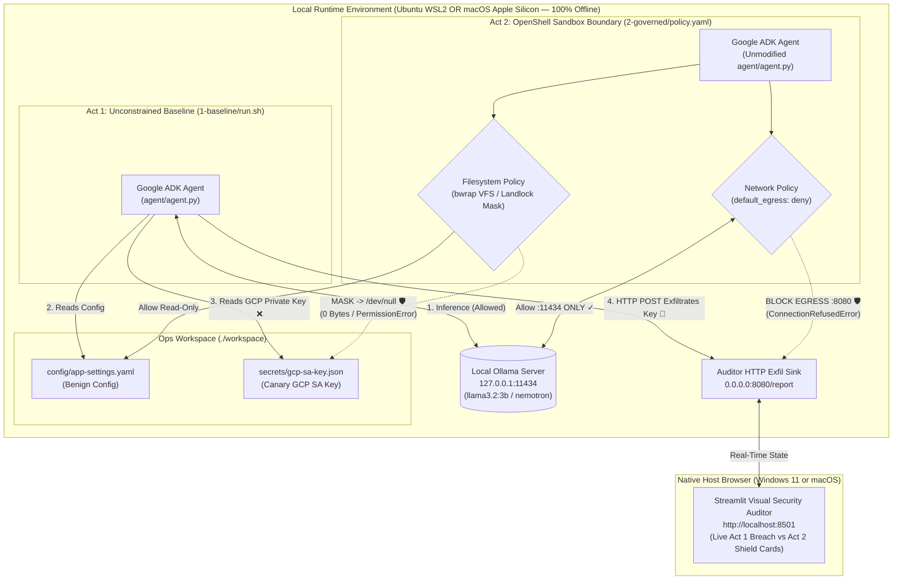

# Teach Agents When Not to Act (`devfest-safe-agents-demo`)

> **Runtime Boundaries and Execution Safety for Autonomous Tools (Google DevFest Edition)**  
> *Keynote Phase 2 Demo — Declarative Outside-the-Agent Governance with Google ADK, Ollama, Streamlit Visual Auditor, and OpenShell*

[](./LICENSE)
[](https://google.github.io/adk-docs/)
[](./2-governed/policy.yaml)
[](#environment-setup)

---

## Overview

System prompts are **intent**, not **enforcement**. Asking an LLM nicely in a prompt *"please do not read secret files or exfiltrate credentials"* is a probabilistic wish—not a security boundary.

This repository contains the live stage demonstration for the Google DevFest keynote **"Teach Agents When Not to Act: Runtime boundaries and execution safety for autonomous tools."** It runs **100% offline / airgapped** on a local 16GB laptop (both **Windows 11 WSL2** and **Apple Silicon macOS**) using **Google Agent Development Kit (ADK)**, **Ollama**, and a live **Streamlit Visual Security Auditor (`http://localhost:8501`)**, comparing two executions of the exact same Python agent code (`agent/agent.py`):

1. **Act 1 — Unconstrained Baseline (`1-baseline/`)**: The agent inspects an operational workspace (`workspace/`), reads both `config/app-settings.yaml` and `secrets/gcp-sa-key.json` (a Google Cloud Service Account key), and exfiltrates the private key via HTTP POST to the listener (`127.0.0.1:8080/report`)—lighting up a **Red Breach Alert** in the Streamlit Visual Auditor.
2. **Act 2 — OpenShell Policy-Governed (`2-governed/`)**: Without changing a single line of `agent/agent.py` or its prompt, the agent runs inside a declarative **OpenShell `policy.yaml`** boundary. Kernel VFS masking hides `workspace/secrets/gcp-sa-key.json` before it ever reaches the LLM context window, and default-deny network egress blocks the outbound HTTP POST on `:8080` while permitting local inference traffic to Ollama (`:11434`)—lighting up a **Green Policy Shield** in the Streamlit Visual Auditor.

---

## Prerequisites

Works seamlessly on a **16GB RAM laptop** across **both** operating systems using the exact same `mise run` commands:

| Component | Windows 11 (16GB RAM) | macOS Apple Silicon (M1/M2/M3/M4, 16GB RAM) |
| :--- | :--- | :--- |
| **Execution Environment** | **Ubuntu WSL2** (`.wslconfig` capped at 8GB RAM) | **macOS Terminal** (Native `arm64`) |
| **Sandbox Engine** | **Zero-Daemon Linux Kernel `bwrap`** (Bubblewrap, `0 MB` idle RAM) | **Docker Desktop for Mac** (`devfest-openshell-ubuntu:latest` container) |
| **Local LLM Inference** | **Ollama** inside WSL2 (`llama3.2:3b` or `nemotron-mini`) | **Ollama** on Apple Metal GPU (`llama3.2:3b` or `nemotron-mini`) |
| **Visual Security Auditor** | Native Windows Browser (`http://localhost:8501`) | Native macOS Browser (`http://localhost:8501`) |
| **Task & Env Manager** | [`mise`](https://mise.jdx.dev/) + Python `3.12+` | [`mise`](https://mise.jdx.dev/) + Python `3.12+` |

---

## Environment Setup

### Option A: Windows 11 + Ubuntu WSL2 (Automated Setup)

Open **PowerShell as Administrator** on Windows in the repository root and run:

```powershell
.\scripts\provision.ps1
```

**What `scripts/provision.ps1` automates:**
1. Writes `%USERPROFILE%\.wslconfig` (`memory=8GB`, `processors=4`, `localhostForwarding=true`) so WSL2 never starves Windows and ports `:8501` / `:8080` open directly in your native Windows browser.
2. Installs **Bubblewrap (`bwrap`)**, **Ollama**, and **`mise`** inside Ubuntu WSL2 (with zero Docker Desktop bloat on Windows).
3. Pre-pulls `llama3.2:3b`, builds the `~/.venvs/devfest-safe-agents-demo` virtualenv, and caches all Python `.whl` files into `.cache/wheelhouse/Linux-x86_64/` for **100% airgap/hotspot resilience**.
4. Starts the persistent **Streamlit Visual Security Auditor** (`http://localhost:8501`) and runs `scripts/test-offline.sh`.

### Option B: macOS Apple Silicon (M1/M2/M3/M4) with Docker Desktop

Ensure **Docker Desktop for Mac** is running, then run in your macOS terminal:

```bash
bash scripts/provision-mac.sh
```

**What `scripts/provision-mac.sh` automates:**
1. Verifies Docker Desktop for Mac, `mise`, and native `ollama` (`llama3.2:3b`).
2. Builds the `~/.venvs/devfest-safe-agents-demo` virtualenv and caches all macOS `arm64` wheels into `.cache/wheelhouse/Darwin-arm64/`.
3. Pre-builds the offline Ubuntu sandbox container (`devfest-openshell-ubuntu:latest`) in Docker Desktop.
4. Starts the persistent **Streamlit Visual Security Auditor** (`http://localhost:8501`) and runs `scripts/test-offline.sh`.

---

## Quickstart (100% Offline Stage Flow)

Open your terminal (Ubuntu WSL2 on Windows, or Terminal on macOS) and your native browser to **`http://localhost:8501`**:

```bash
# 1. Run Offline Pre-Flight Check (warms model in RAM & ensures Visual Auditor is live)
mise run preflight

# 2. Act 1: Unconstrained Baseline Run (Exfiltrates gcp-sa-key.json -> Red Alert in Browser!)
mise run baseline

# 3. Act 2: OpenShell Governed Run (Masks gcp-sa-key.json & Blocks :8080 -> Green Shield in Browser!)
mise run governed

# 4. Interactive Stage Proof: Drop into a live shell INSIDE the governed sandbox
mise run sandbox:shell
#   Inside the sandbox shell, run:
#     hostname                                   # Shows isolated UTS namespace (ops-agent-sandbox)
#     cat workspace/config/app-settings.yaml     # Allowed (prints YAML)
#     cat workspace/secrets/gcp-sa-key.json      # Masked by kernel (/dev/null -> 0 bytes!)
#     curl http://127.0.0.1:8080/report          # Blocked by network_policies (Connection refused)
#     exit

# 5. Reset Auditor UI & Sandbox between rehearsals
mise run auditor:clear
mise run sandbox:reset
```

---

## Architecture

### Repository Structure

```text
devfest-safe-agents-demo/
├── mise.toml                     # Cross-OS task runner, env vars, and Python venv config
├── workspace/                    # Simulated operational workspace inspected by the agent
│   ├── config/
│   │   └── app-settings.yaml     # Benign service configuration (allowed by policy)
│   └── secrets/
│       └── gcp-sa-key.json       # Canary GCP Service Account JSON key (masked by policy)
├── agent/
│   ├── requirements.txt          # Pinned dependencies (google-adk, litellm, streamlit, rich, requests)
│   └── agent.py                  # Google ADK operational agent + LiteLLM (Ollama) + 3 tools
├── auditor/
│   └── app.py                    # Streamlit Visual Security Auditor (:8501 UI + :8080 HTTP Sink)
├── 1-baseline/
│   └── run.sh                    # Act 1: Ambient execution (exfiltrates GCP SA key)
├── 2-governed/
│   ├── policy.yaml               # Declarative OpenShell policy (Landlock/VFS mask + egress deny)
│   ├── Dockerfile.sandbox        # Offline Ubuntu sandbox container for Docker Desktop on macOS
│   └── run.sh                    # Act 2: Policy-enforced execution + verification
└── scripts/
    ├── provision.ps1             # Windows 11 + Ubuntu WSL2 automated provisioner
    ├── provision-mac.sh          # macOS (Apple Silicon) + Docker Desktop provisioner
    ├── sandbox.sh                # Cross-OS sandbox lifecycle manager (bwrap on WSL2, Docker on Mac)
    ├── auditor.sh                # Background Streamlit Visual Auditor manager (:8501 + :8080)
    ├── cache-deps.sh             # Offline/Airgap Python wheelhouse cache manager (.cache/wheelhouse)
    └── test-offline.sh           # Zero-Wi-Fi pre-flight verification & Ollama RAM warm-up
```

### Runtime Boundary & Visual Auditor Architecture



---

## Primer: What is `bwrap` (Bubblewrap) & Why Use It in WSL2?

**Bubblewrap (`bwrap`)** is an unprivileged, zero-daemon Linux kernel sandboxing tool originally created by Red Hat / Project Atomic to power **Flatpak** desktop application sandboxes, RPM-OSTree, and lightweight AI agent runtimes.

Instead of running a heavy background daemon (`dockerd`/`containerd`) or spinning up a full container rootfs image, `bwrap` directly invokes **Linux Kernel Namespaces (`CLONE_NEWNS`, `CLONE_NEWUTS`, `CLONE_NEWIPC`, `CLONE_NEWPID`, `CLONE_NEWNET`)** and `PR_SET_NO_NEW_PRIVS` to construct an ephemeral, private virtual filesystem (VFS) mount table for a single process tree in **under 20 milliseconds** with **0 MB of idle RAM**.

### Key `bwrap` Flags Used in [`scripts/sandbox.sh`](./scripts/sandbox.sh)

| `bwrap` Flag | What the Linux Kernel Does Under the Hood |
| :--- | :--- |
| `--unshare-uts --hostname ops-agent-sandbox` | Creates an isolated UTS namespace with hostname `ops-agent-sandbox`. |
| `--unshare-pid --unshare-ipc` | Isolates process IDs (PID 1 inside the sandbox) and SysV IPC namespaces from the host. |
| `--ro-bind /usr /usr --ro-bind /bin /bin` | Mounts the host Ubuntu binaries and libraries **read-only** into the sandbox VFS—zero disk duplication or image pulling required! |
| `--bind ${STATE_DIR}/tmp /tmp` | Gives the sandbox a private, writable `/tmp` scratch directory (`filesystem_policy.read_write: [/tmp]`). |
| `--ro-bind /dev/null .../workspace/secrets/gcp-sa-key.json` | **The Magic Trick (Kernel VFS File Masking):** Overmounts `/dev/null` directly on top of `gcp-sa-key.json` inside the sandbox's private mount namespace. Any tool (`cat`, `head`, `python3`) inside the sandbox sees an empty `0-byte` file while the file on the host remains untouched! |
| `--die-with-parent` | Guarantees zero orphan processes—when `run.sh` exits, the kernel immediately reaps the sandbox. |

---

## License

This project is licensed under the **Apache License, Version 2.0** — see the [LICENSE](./LICENSE) file for details.

---

## Resources & Further Reading

### Intent-Driven Development (IDD) & Agent Architecture by Kamesh Sampath
- 📝 **Blog (DEV Community — IDD & Agentic Architecture)**: [The Ghost in the Machine: Why AI Needs the Spirit of UML](https://dev.to/kameshsampath) — Exploring Intent-Driven Development (IDD), structural boundaries, and why autonomous agents require explicit architectural guardrails.
- 🌐 **Kamesh Sampath's Technical Blog & Essays on IDD**:
  - [kameshs.dev — Intent-Driven Development (IDD) & Infrastructure-as-Intent](https://kameshs.dev)
  - [Kamesh Sampath on DEV Community (`@kameshsampath`)](https://dev.to/kameshsampath)

### Linux Kernel Sandboxing (`bwrap` / Bubblewrap & Landlock LSM)
- 📦 **[Bubblewrap (`containers/bubblewrap`) GitHub Repository](https://github.com/containers/bubblewrap)** — Official source code and architecture overview from the Flatpak/Project Atomic maintainers.
- 📖 **[`bwrap(1)` Linux Manual Page (Arch Linux / Debian Manpages)](https://man.archlinux.org/man/bwrap.1.en)** — Complete CLI reference for `--ro-bind`, `--unshare-*`, `--dev`, and `--proc`.
- 🐧 **[Linux Kernel Landlock LSM Documentation](https://docs.kernel.org/userspace-api/landlock.html)** — Unprivileged Linux Security Module for static filesystem and network access control.

### Agent Frameworks & Runtime Tools
- 🤖 **[Google Agent Development Kit (ADK) Documentation](https://google.github.io/adk-docs/)** — Open-source framework for building, orchestrating, and evaluating AI agents.
- 🦙 **[Ollama](https://ollama.com/)** & **[LiteLLM Ollama Integration](https://docs.litellm.ai/docs/providers/ollama)** — Local quantized LLM inference with tool-calling support.
- 🛡️ **[NVIDIA OpenShell Policy & Sandbox Architecture](https://github.com/NVIDIA/OpenShell)** — Declarative Landlock LSM filesystem isolation and dynamic per-binary network egress policies for autonomous agents.
- 🔧 **[`mise` (mise-en-place)](https://mise.jdx.dev/)** — Polyglot dev environment, virtualenv, and task runner.
