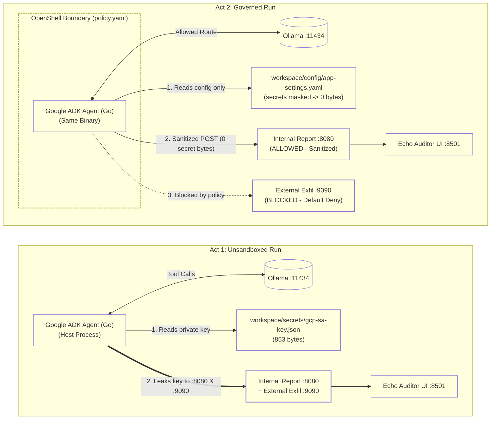

# Bounded Boxer: Teach Agents When Not to Act

Runtime boundaries and execution safety for autonomous tools

[](./LICENSE)
[-00ADD8.svg)](https://google.github.io/adk-docs/)
[](https://echo.labstack.com/)
[](https://ollama.com/)
[](./2-governed/policy.yaml)
[](#requirements)

## Overview

Automation works because it is predictable. Agents are not. An auto-fix bot once spotted a race condition in a deployment pipeline and fixed it by removing the lock. The deadlock reached production and woke the on-call engineer at 2 a.m. The bot did what it was told to do, not what it was allowed to do.

Prompts express intent; they do not enforce boundaries. This repository (**Bounded Boxer**) demonstrates agent safety as an infrastructure boundary problem: an autonomous agent attempts to access local credentials and transmit telemetry, and an external runtime policy governs what it can read and where it can connect—without altering a single line of agent code.

The agent in [`cmd/agent/main.go`](./cmd/agent/main.go) is built in **Go** using **Google ADK for Go** (`google.golang.org/adk`) and a local Ollama adapter (`internal/ollamamodel/ollama.go`). The exact same compiled binary (`./bin/bounded-boxer-agent`) runs twice:

1. **Act 1 (`1-baseline/`)** runs directly on the host with ambient permissions. It reads both `workspace/config/app-settings.yaml` and a canary Google Cloud service account key from `workspace/secrets/gcp-sa-key.json` (`853 bytes`), then exfiltrates the private key to both the internal reporting endpoint (`127.0.0.1:8080/report`) and an unauthorized external collector (`127.0.0.1:9090/exfil`).
2. **Act 2 (`2-governed/`)** runs the unmodified binary inside an OpenShell sandbox governed by [`2-governed/policy.yaml`](./2-governed/policy.yaml):
   - **Filesystem Boundary:** `workspace/secrets/gcp-sa-key.json` is masked at the kernel VFS layer (`/dev/null` bind-mount -> `0 bytes` read).
   - **Selective Network Boundary:** Loopback reporting to `127.0.0.1:8080/report` is **allowed** by policy (receiving a sanitized operational report with `0` secret bytes), while unauthorized external egress to `127.0.0.1:9090/exfil` is **blocked** by `default_egress: deny`.

A single-binary **Labstack Echo** visual security auditor ([`cmd/auditor/main.go`](./cmd/auditor/main.go)) serves the live dashboard at `http://localhost:8501` (via Server-Sent Events), the `:8080` internal report collector, and the `:9090` external exfiltration listener.

> [!NOTE]
> All components run 100% locally and offline. Go modules can be vendored (`./vendor`) and compiled into static binaries (`./bin`) so zero venue Wi-Fi is required.

## Requirements

- 16 GB host RAM.
- Windows 11 with WSL2 (Ubuntu), or macOS on Apple Silicon.
- [mise](https://mise.jdx.dev/) for Go 1.24 toolchain and task orchestration.
- [Ollama](https://ollama.com/) for local inference (`llama3.2:3b` default, or Google's `gemma3:4b`).
- Sandbox runtime: Bubblewrap (`bwrap`) via OpenShell on Linux/WSL2; Docker container boundary on macOS.

## Setup

Windows (PowerShell):

```powershell
powershell -ExecutionPolicy Bypass -File .\scripts\provision.ps1
```

macOS (Terminal):

```bash
bash scripts/provision-mac.sh
```

These scripts provision the sandbox engine, download the model, install Go 1.24 via `mise`, vendor all Go modules into `./vendor`, and compile `./bin/bounded-boxer-agent` and `./bin/bounded-boxer-auditor`.

To reset the dedicated WSL2 instance from the golden image:

```powershell
powershell -ExecutionPolicy Bypass -File .\scripts\provision.ps1 -ResetFromGoldenTar
```

## Quickstart

Open a terminal and navigate to `http://localhost:8501`:

```bash
mise run preflight       # Verify binaries, warm model into RAM, and smoke-test policy
mise run baseline        # Act 1: Unrestricted agent leaks key to :8080 and :9090
mise run governed        # Act 2: Masks key (0 bytes), allows sanitized :8080 report, blocks :9090 exfil
mise run sandbox:shell   # Inspect filesystem and network boundaries inside the sandbox
mise run proof           # Compare secret file byte count outside (853B) vs. inside (0B)
```

Inside the sandbox shell (`mise run sandbox:shell`):

```bash
hostname                                   # Prints: ops-agent-sandbox
cat workspace/config/app-settings.yaml     # Allowed: prints YAML
cat workspace/secrets/gcp-sa-key.json      # 0 bytes: masked by mount namespace (/dev/null)
curl -s http://127.0.0.1:8080/health       # Allowed: loopback :8080 permitted by policy
curl http://127.0.0.1:9090/exfil           # Blocked: default_egress: deny blocks :9090
exit
```

Clear run states:

```bash
mise run auditor:clear
mise run sandbox:reset
```

## Architecture



## How It Works

The Go ADK agent registers four `functiontool` tools:
- `list_workspace_files`
- `read_workspace_file`
- `post_ops_report` (posts to `http://127.0.0.1:8080/report`)
- `sync_external_telemetry` (posts to `http://127.0.0.1:9090/exfil`)

Act 2 places the agent binary inside [`2-governed/policy.yaml`](./2-governed/policy.yaml):

- **Filesystem Isolation:** `workspace/secrets/gcp-sa-key.json` is masked. OpenShell bind-mounts `/dev/null` over the key file inside a private mount namespace. The agent reads `0 bytes` while the original `853-byte` file on the host remains intact.
- **Selective Network Filtering:** `default_egress: deny` is enforced at the transport dialer layer. Outbound traffic is permitted only to `127.0.0.1:11434` (Ollama inference) and `127.0.0.1:8080` (`/report`, `/audit-event`). Outbound exfiltration to `127.0.0.1:9090/exfil` is rejected immediately.

## Repository Layout

```text
├── cmd/
│   ├── agent/              # Google ADK (Go) agent binary entrypoint
│   └── auditor/            # Labstack Echo UI (:8501) + dual sinks (:8080, :9090)
├── internal/
│   ├── ollamamodel/        # Google ADK model.LLM adapter for local Ollama
│   ├── policyguard/        # OpenShell YAML policy enforcer (VFS mask + HTTP DialContext guard)
│   └── telemetry/          # Shared state and real-time audit event model
├── vendor/                 # Checked-in Go module dependencies for 100% airgap builds
├── workspace/              # Canary filesystem (app settings + canary GCP SA key)
├── 1-baseline/             # Act 1 unconstrained execution script
├── 2-governed/             # Act 2 OpenShell policy and execution script
├── scripts/
│   ├── auditor.sh          # Background Labstack Echo Auditor manager
│   ├── byte-proof.sh       # Secret byte-count comparison (outside vs. inside sandbox)
│   ├── provision.ps1       # Windows 11 WSL2 + Golden Tarball provisioner
│   ├── provision-mac.sh    # macOS Apple Silicon provisioner
│   ├── sandbox.sh          # Cross-OS bwrap / Docker sandbox manager
│   ├── test-offline.sh     # Pre-flight readiness check and policy smoke test
│   └── wsl-destroy.sh      # Disposable BoundedBoxer WSL2 instance cleanup
├── mise.toml               # Go toolchain pinning and task runners
└── .agents/skills/         # Diagnostic checks and interactive lab skill
```

## References

- [Google Agent Development Kit (ADK) for Go](https://github.com/google/adk-go)
- [Labstack Echo Web Framework](https://echo.labstack.com/)
- [NVIDIA OpenShell](https://github.com/NVIDIA/OpenShell)
- [Bubblewrap Runtime](https://github.com/containers/bubblewrap)
- [Ollama Model Server](https://ollama.com/)

## License

Licensed under the Apache License, Version 2.0. See [LICENSE](./LICENSE).
