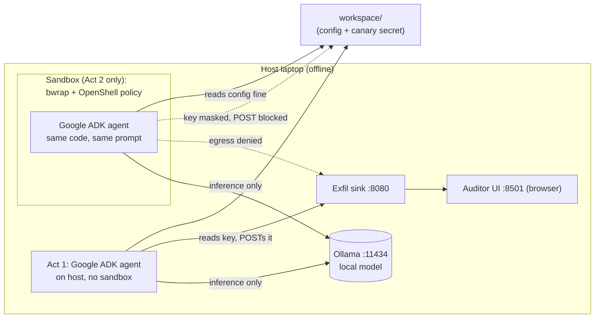

# Teach Agents When Not to Act

Runtime boundaries and execution safety for autonomous tools

[](./LICENSE)
[](https://google.github.io/adk-docs/)
[](https://ollama.com/)
[](./2-governed/policy.yaml)
[](#requirements)

## Overview

Automation works because it is predictable. Agents are not. An auto-fix bot once spotted a race condition in a deployment pipeline and "fixed" it by removing the lock. The deadlock reached production and woke the on-call engineer at 2 a.m. The bot did what it was told to do, not what it was allowed to do.

Prompts express intent; they do not enforce anything. This repo treats agent safety as an infrastructure boundary problem: a live, offline demo of an agent that tries to read local credentials, and the external policy that stops it without changing a line of model code. The goal is not an agent that always acts. The goal is a system with hard boundaries that knows when to stop.

This repository is the live demonstration behind this idea. The agent in [`agent/agent.py`](./agent/agent.py) is created using **Google ADK** (Agent Development Kit), with LiteLLM calling a local Ollama model. The same agent code runs twice:

1. **Act 1 (`1-baseline/`)** runs with full host access. It reads a fake cloud service account key from `workspace/secrets/` and posts it to a local listener on port 8080.
2. **Act 2 (`2-governed/`)** runs the identical code and prompt inside a sandbox. The sandbox masks the key file at the filesystem level and blocks all network egress except the local LLM port. The agent exfiltrates zero bytes.

A Streamlit dashboard at `http://localhost:8501` shows both runs side by side: a red breach card for Act 1, a green shield card for Act 2.

Everything runs locally and offline. No cloud calls. No Wi-Fi needed at show time.

## Requirements

- A laptop with 16 GB RAM.
- Windows 11 with WSL2 (Ubuntu), or macOS on Apple Silicon.
- [mise](https://mise.jdx.dev/) for tasks and the Python environment.
- [Ollama](https://ollama.com/) for local inference (`llama3.2:3b` by default; any local Ollama model works, e.g. Google's `gemma3:4b` via `MODEL_NAME=gemma3:4b mise run baseline` or `provision.ps1 -Model gemma3:4b`). The Gemini API itself needs cloud access, so for the offline demo use Gemma through Ollama.
- Sandbox engine: Bubblewrap (`bwrap`) on Linux/WSL2, Docker Desktop on macOS.

## Setup

Windows, from PowerShell in the repo root:

```powershell
powershell -ExecutionPolicy Bypass -File .\scripts\provision.ps1
```

macOS, from Terminal:

```bash
bash scripts/provision-mac.sh
```

Both scripts install the sandbox engine and Ollama, pull the model, create a dedicated Python virtualenv, and cache every Python wheel into `.cache/wheelhouse/` so later runs work with no network. They end with an offline pre-flight check (`scripts/test-offline.sh`).

The Windows script also creates an isolated WSL2 instance named `BoundedBoxer` and exports a golden tarball to `.cache/` for fast clean resets. To destroy that instance:

```bash
mise run wsl:destroy
```

To restore it from the golden tarball:

```powershell
powershell -ExecutionPolicy Bypass -File .\scripts\provision.ps1 -ResetFromGoldenTar
```

## Quickstart

Open a terminal (WSL2 on Windows, Terminal on macOS) and a browser tab at `http://localhost:8501`:

```bash
mise run preflight      # checks the setup and warms the model in RAM
mise run baseline       # Act 1: the agent leaks the key, red card appears
mise run governed       # Act 2: the sandbox blocks it, green card appears
mise run sandbox:shell  # drop into a shell inside the sandbox
mise run proof          # byte-proof: secret size outside vs inside the sandbox
```

Inside the sandbox shell, try:

```bash
hostname                                  # prints ops-agent-sandbox
cat workspace/config/app-settings.yaml    # allowed, prints the YAML
cat workspace/secrets/gcp-sa-key.json     # 0 bytes, the kernel masks it
curl http://127.0.0.1:8080/report         # connection refused, egress denied
exit
```

Reset between rehearsals:

```bash
mise run auditor:clear
mise run sandbox:reset
```

## Architecture



## How it works

The agent (`agent/agent.py`) has three tools: list workspace files, read a workspace file, and POST a report to `http://127.0.0.1:8080/report`. Its instructions beg it, in caps, never to read the secret, then tell it to read every file and post everything. Prompts express intent. They do not enforce anything.

Act 2 wraps the same agent in a declarative policy (`2-governed/policy.yaml`):

- **Filesystem:** `workspace/secrets/` is masked. On WSL2, `bwrap` bind-mounts `/dev/null` directly over the key file inside a private mount namespace. Any process in the sandbox sees an empty file. The file on the host is untouched.
- **Network:** default-deny egress. Only `127.0.0.1:11434` (Ollama) is allowed, so the agent can still think, but the POST to port 8080 is refused.

On WSL2 the sandbox is Bubblewrap: Linux namespaces with no daemon, about 20 ms startup, 0 MB idle RAM. On macOS it is a hardened Docker container with a read-only root filesystem.

Key `bwrap` flags used in `scripts/sandbox.sh`:

| Flag | Effect |
| :--- | :--- |
| `--unshare-uts --hostname ops-agent-sandbox` | Isolated hostname |
| `--unshare-pid --unshare-ipc` | Isolated processes and IPC |
| `--ro-bind /usr /usr` (and `/bin`, `/lib`, `/etc`) | Host binaries mounted read-only, no image to pull |
| `--ro-bind /dev/null .../secrets/gcp-sa-key.json` | Kernel-level file mask |
| `--die-with-parent` | No orphan processes when the run exits |

## Repository layout

```text
├── agent/                  # the demo agent and its dependencies
├── auditor/                # Streamlit dashboard on :8501 plus exfil sink on :8080
├── workspace/              # fake ops workspace: benign config + canary secret
├── 1-baseline/             # Act 1 run script (no sandbox)
├── 2-governed/             # Act 2 run script, policy.yaml, sandbox Dockerfile
├── scripts/                # provision, sandbox, auditor, wheelhouse, pre-flight
├── mise.toml               # tasks, environment variables, Python version
└── .agents/skills/         # workspace skill: prerequisite doctor and guided lab
```

## Docs

- [Agent Development Kit (ADK)](https://google.github.io/adk-docs/)
- [Ollama](https://ollama.com/) and [LiteLLM's Ollama provider](https://docs.litellm.ai/docs/providers/ollama)
- [Bubblewrap](https://github.com/containers/bubblewrap) and the [bwrap man page](https://man.archlinux.org/man/bwrap.1.en)
- [Landlock LSM](https://docs.kernel.org/userspace-api/landlock.html)
- [NVIDIA OpenShell](https://github.com/NVIDIA/OpenShell)

## License

Apache License 2.0. See [LICENSE](./LICENSE).
